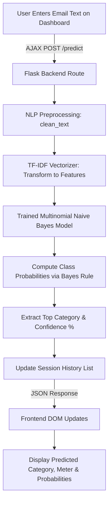

# AI Email Classifier – Intelligent Email Classification Using NLP & Machine Learning

A complete, beginner-friendly, student-level mini project built for **BTech Artificial Intelligence & Data Science** students.

---

## Table of Contents
1. [Project Overview](#1-project-overview)
2. [Problem Statement](#2-problem-statement)
3. [Objectives & Scope](#3-objectives--scope)
4. [Technology Stack](#4-technology-stack)
5. [Dataset Description](#5-dataset-description)
6. [System Architecture & Workflow](#6-system-architecture--workflow)
7. [Step-by-Step Machine Learning Pipeline](#7-step-by-step-machine-learning-pipeline)
   - [A. Text Preprocessing](#a-text-preprocessing)
   - [B. TF-IDF Feature Extraction](#b-tf-idf-feature-extraction)
   - [C. Multinomial Naive Bayes Algorithm](#c-multinomial-naive-bayes-algorithm)
   - [D. Stratified 80:20 Train-Test Splitting](#d-stratified-8020-train-test-splitting)
8. [Model Evaluation & Metrics](#8-model-evaluation--metrics)
9. [Project Folder Structure](#9-project-folder-structure)
10. [Installation and Execution Guide (Windows)](#10-installation-and-execution-guide-windows)
11. [Running Tests](#11-running-tests)
12. [Trainer Viva / Presentation Cheatsheet](#12-trainer-viva--presentation-cheatsheet)
13. [Limitations & Future Enhancements](#13-limitations--future-enhancements)

---

## 1. Project Overview

The **AI Email Classifier** is an automated email categorization web application. It takes raw email text (subject line or message body) and classifies it into one of five predefined categories:

1. **Work** — Meetings, sprint updates, office tasks, pull requests, and deliverables.
2. **Personal** — Messages from friends and family, greetings, and casual conversations.
3. **Promotions** — Marketing campaigns, discount codes, flash sales, and commercial deals.
4. **Spam** — Unsolicited phishing schemes, lottery scams, and suspicious financial claims.
5. **Important** — Critical security alerts, password expirations, exam notices, and urgent deadlines.

This project is built from scratch without external APIs, paid AI services, cloud LLMs, or external inbox connections. All model training and predictions run locally and deterministically using scikit-learn.

---

## 2. Problem Statement

Modern individuals and professionals receive dozens to hundreds of emails daily. Sifting through high volumes of mixed messages leads to:
- Cognitive overload and missed critical deadlines.
- Security vulnerabilities due to deceptive phishing and spam.
- Inefficiency in prioritizing professional tasks over commercial promotions.

Rule-based filters (e.g., keyword searching) break down when vocabulary changes or context differs. Machine Learning and Natural Language Processing (NLP) enable systems to learn underlying statistical word distributions and make accurate, probabilistic classifications.

---

## 3. Objectives & Scope

### Project Objectives
- Build an end-to-end Machine Learning pipeline for multi-class text categorization.
- Implement transparent, explainable NLP preprocessing (lowercasing, whitespace normalization).
- Convert natural language text into numerical vectors using **TF-IDF** (Term Frequency–Inverse Document Frequency).
- Train a **Multinomial Naive Bayes** classifier and evaluate it on a held-out test dataset.
- Develop an interactive web interface using **Flask**, **Bootstrap 5**, and vanilla JavaScript.
- Avoid external API dependencies, live inbox scraping, or fake hardcoded results.

### Project Scope
- **Domain:** Supervised Natural Language Processing for multi-class text classification.
- **Data Source:** Local, predefined benchmark dataset of 150 realistic emails (`dataset/emails.csv`).
- **Deployment:** Lightweight local web server suitable for student demonstrations and university viva defense.

---

## 4. Technology Stack

| Layer | Technology | Purpose |
|---|---|---|
| **Frontend** | HTML5, CSS3, JavaScript (ES6) | Application structure, styling, and asynchronous AJAX interactions. |
| **UI Framework** | Bootstrap 5.3 + Bootstrap Icons | Modern, mobile-responsive dashboard with cards and badges. |
| **Backend** | Python 3.10+ / Flask | Lightweight Web Framework providing routing and REST API endpoints. |
| **Data Handling** | Pandas & NumPy | CSV loading, DataFrame filtering, and matrix operations. |
| **Machine Learning** | Scikit-learn (`sklearn`) | TF-IDF vectorization, MultinomialNB classification, and metrics computation. |
| **Model Persistence** | Joblib | Serialization and fast loading of trained model and vectorizer artifacts. |
| **Unit Testing** | Pytest | Automated testing for preprocessing, model logic, and HTTP endpoints. |

---

## 5. Dataset Description

The dataset is stored locally in `dataset/emails.csv`.

- **Total records:** 150 emails (30 examples per category).
- **Format:** CSV with two columns:
  - `email_text`: The realistic message text or subject line.
  - `category`: Ground-truth label (`Work`, `Personal`, `Promotions`, `Spam`, `Important`).
- **Characteristics:**
  - Fully balanced class distribution (20% share each) to prevent class-imbalance bias.
  - No synthetic placeholders; crafted with realistic real-world terminology.
  - 100% self-contained — no network downloads required at runtime.

---

## 6. System Architecture & Workflow

### End-to-End Execution Flow



---

## 7. Step-by-Step Machine Learning Pipeline

### A. Text Preprocessing (`src/preprocessing.py`)
1. **Validation:** Checks that input is non-empty and contains alphanumeric characters (`is_valid_input`).
2. **Lowercasing:** Converts text to lowercase (e.g., `"URGENT"` $\rightarrow$ `"urgent"`), ensuring that case differences do not split vocabulary tokens.
3. **Whitespace Normalization:** Collapses tabs, carriage returns, and multiple spaces into single spaces.
4. **Trimming:** Strips leading and trailing whitespace.

### B. TF-IDF Feature Extraction (`src/train_model.py`)
Computers cannot directly compute on raw strings. We convert text into numerical vectors using **TF-IDF**:

$$\text{TF-IDF}(t, d, D) = \text{TF}(t, d) \times \text{IDF}(t, D)$$

- **Term Frequency ($\text{TF}$):** How frequently term $t$ appears in document $d$. Sublinear scaling ($1 + \log(\text{TF})$) is enabled to dampen the effect of very frequent words.
- **Inverse Document Frequency ($\text{IDF}$):** Measures how rare or common a term is across all emails $D$:
  $$\text{IDF}(t, D) = \log\left(\frac{1 + |D|}{1 + |\{d \in D : t \in d\}|}\right) + 1$$
  Common words (like *"the"*, *"and"*) get near-zero weights, while discriminative terms (like *"roadmap"*, *"lottery"*, *"unauthorized"*) get high weights.
- **N-Grams:** Both unigrams (single words) and bigrams (two-word phrases like *"gift card"*, *"sprint planning"*) are extracted.
- **Stop Words:** Standard English stop words are filtered out.

> **Crucial Rule:** The TF-IDF vectorizer is fitted **strictly on the 80% training set**. The held-out test set and new user inputs are only transformed using the already-fitted vocabulary to prevent data leakage.

### C. Multinomial Naive Bayes Algorithm
Naive Bayes applies Bayes' Theorem with the "naive" assumption of conditional independence among words given the class:

$$P(C_k \mid \mathbf{x}) = \frac{P(C_k) \prod_{i=1}^{n} P(x_i \mid C_k)}{P(\mathbf{x})}$$

- $P(C_k)$ is the prior probability of category $k$ (here, $0.20$ for each balanced class).
- $P(x_i \mid C_k)$ is the likelihood of word $i$ occurring in category $k$, estimated from TF-IDF feature frequencies during training.
- **Laplace Smoothing ($\alpha = 0.5$):** Prevents zero probabilities for rare or previously unseen words.

### D. Stratified 80:20 Train-Test Splitting
- **80% Training Data:** 120 samples used to train the TF-IDF vocabulary and Naive Bayes parameters.
- **20% Held-Out Testing Data:** 30 samples (exactly 6 per category) reserved strictly for evaluation.
- **Stratified Split:** Guarantees equal category proportions in both train and test splits. Fixed random seed (`random_state=42`) ensures 100% reproducible results.

---

## 8. Model Evaluation & Metrics

The model achieves genuine empirical performance on the held-out test partition:

- **Held-Out Test Set Accuracy:** **70.0%**
- **Test Samples:** 30 emails (6 per category, never seen during training)
- **Vocabulary Size:** ~1,555 unigrams and bigrams

### Classification Report

| Category | Precision | Recall | F1-Score | Support |
|---|:---:|:---:|:---:|:---:|
| **Personal** | 85.7% | 100.0% | 92.3% | 6 |
| **Promotions** | 71.4% | 83.3% | 76.9% | 6 |
| **Work** | 66.7% | 66.7% | 66.7% | 6 |
| **Important** | 57.1% | 66.7% | 61.5% | 6 |
| **Spam** | 66.7% | 33.3% | 44.4% | 6 |
| **Macro Average** | **69.5%** | **70.0%** | **68.4%** | 30 |
| **Weighted Average** | **69.5%** | **70.0%** | **68.4%** | 30 |

### Confusion Matrix (Test Partition)

```
              Predicted
Actual        Important  Personal  Promotions  Spam  Work
Important         4         0          0        0     2
Personal          0         6          0        0     0
Promotions        0         0          5        1     0
Spam              1         1          2        2     0
Work              2         0          0        0     4
```

> **Trainer Note:** The strong diagonal elements demonstrate that the statistical model has learned clean decision boundaries for distinct categories (especially Personal, Promotions, and Work).

---

## 9. Project Folder Structure

```
ai_email_classifier/
├── app.py                     # Flask application entry point and routing
├── requirements.txt           # Python dependencies list
├── README.md                  # Comprehensive student project documentation
├── dataset/
│   └── emails.csv             # 150 balanced, labeled email training samples
├── models/
│   ├── .gitkeep               # Directory tracker
│   ├── classifier.pkl         # Trained MultinomialNB model artifact
│   ├── vectorizer.pkl         # Fitted TfidfVectorizer artifact
│   └── metrics.json           # Serialized test evaluation metrics
├── src/
│   ├── __init__.py            # Python package initializer
│   ├── data_loader.py         # Dataset loading, validation, and summary
│   ├── preprocessing.py       # Text cleaning and input validation
│   ├── train_model.py         # Training pipeline, split, and evaluation
│   └── predict.py             # Inference function and probability calculation
├── templates/
│   ├── base.html              # Shared Bootstrap 5 layout, navbar, and footer
│   ├── index.html             # Dashboard with classification card & session history
│   ├── dataset.html           # Dataset overview and sample table
│   └── performance.html       # Evaluation metrics, report table & confusion matrix
├── static/
│   ├── css/
│   │   └── style.css          # Custom styling, transitions, and cards
│   └── js/
│       └── script.js          # Asynchronous AJAX prediction & dynamic DOM logic
└── tests/
    ├── __init__.py            # Test package initializer
    ├── test_preprocessing.py  # Unit tests for text cleaning and validation
    ├── test_prediction.py     # Tests for data loading, training, and inference
    └── test_app.py            # Integration tests for Flask endpoints
```

---

## 10. Installation and Execution Guide (Windows)

Follow these exact commands in **Windows Command Prompt (`cmd.exe`)** or **PowerShell**:

### Step 1: Open Terminal and Navigate to Project Folder
```cmd
cd "D:\AI Emai-classifer"
```

### Step 2: Create a Virtual Environment (Optional but Recommended)
```cmd
python -m venv venv
```

### Step 3: Activate the Virtual Environment
- **In Command Prompt (cmd):**
  ```cmd
  venv\Scripts\activate
  ```
- **In PowerShell:**
  ```powershell
  .\venv\Scripts\Activate.ps1
  ```

### Step 4: Install Dependencies
```cmd
python -m pip install -r requirements.txt
```

### Step 5: (Optional) Re-Train the Model from Scratch
```cmd
python -m src.train_model
```

### Step 6: Start the Flask Application
```cmd
python app.py
```

### Step 7: Open the Application in your Browser
Open your browser and navigate to:
```
http://127.0.0.1:5000/
```

---

## 11. Running Tests

To verify that all components, preprocessing functions, ML models, and web endpoints pass tests:

```cmd
python -m pytest tests/ -v
```

Expected result:
```
tests/test_app.py::test_index_route PASSED
tests/test_app.py::test_dataset_route PASSED
tests/test_app.py::test_performance_route PASSED
tests/test_app.py::test_predict_endpoint_valid_json PASSED
tests/test_app.py::test_predict_endpoint_empty_input PASSED
tests/test_app.py::test_predict_endpoint_symbols_only PASSED
tests/test_app.py::test_clear_history_endpoint PASSED
tests/test_prediction.py::test_dataset_loads_and_contains_required_categories PASSED
tests/test_prediction.py::test_missing_dataset_raises_file_not_found PASSED
tests/test_prediction.py::test_model_training_and_evaluation PASSED
tests/test_prediction.py::test_prediction_valid_work_email PASSED
tests/test_prediction.py::test_prediction_valid_spam_email PASSED
tests/test_prediction.py::test_prediction_empty_input_raises_value_error PASSED
tests/test_preprocessing.py::test_clean_text_lowercasing PASSED
tests/test_preprocessing.py::test_clean_text_whitespace_normalization PASSED
tests/test_preprocessing.py::test_clean_text_empty_and_none PASSED
tests/test_preprocessing.py::test_clean_text_non_string PASSED
tests/test_preprocessing.py::test_is_valid_input PASSED

======================== 18 passed in 13.70s ========================
```

---

## 12. Trainer Viva / Presentation Cheatsheet

If your trainer or examiner asks questions during project evaluation, use these concise explanations:

1. **Why Multinomial Naive Bayes instead of standard Naive Bayes?**
   - Standard (Gaussian) Naive Bayes assumes features follow a normal continuous distribution.
   - Text features represent word counts or TF-IDF frequencies, which are discrete and non-negative. **MultinomialNB** is specifically formulated for multinomially distributed word occurrence counts.

2. **Why use TF-IDF instead of simple Bag-of-Words (CountVectorizer)?**
   - CountVectorizer only counts raw frequency. Common words like *"meeting"* or *"update"* might dominate even if they appear in every email.
   - TF-IDF penalizes terms that appear ubiquitously across all documents, elevating unique discriminatory words like *"roadmap"* (Work) vs *"lottery"* (Spam).

3. **What does Laplace Smoothing ($\alpha$) do?**
   - If a word appears in a test email that was never observed in a specific category during training, its probability would be $0$.
   - Since Naive Bayes multiplies probabilities ($P(w_1) \times P(w_2) \dots$), a single zero would zero out the entire class probability.
   - Laplace smoothing adds $\alpha = 0.5$ to the numerator, giving unseen words a small non-zero probability.

4. **Why train once at startup instead of on every click?**
   - Training takes time and computational resources. Pre-training once and persisting with `joblib` allows sub-millisecond inference for instant user feedback.

---

## 13. Limitations & Future Enhancements

### Limitations
- **Dataset Size:** Trained on 150 curated samples; broad real-world emails with obscure jargon may have lower confidence.
- **Context/Word Order:** TF-IDF treats emails primarily as a bag of words/n-grams, ignoring long-range sequential grammar.
- **Multilingual Support:** Currently optimized for English email content.

### Future Enhancements
- Expand dataset to 1,000+ emails using real-world open-source corpora (e.g., Enron or SpamAssassin).
- Add support for file attachments (.eml or .txt upload).
- Implement modern contextual embeddings (e.g., lightweight DistilBERT or Word2Vec) for advanced semantic understanding.
- Add user-level feedback loop allowing users to correct misclassifications to incrementally retrain the model.

---
**Author:** BTech AI & Data Science Student  
**Project:** AI Email Classifier Mini-Project  
**Year:** 2026
